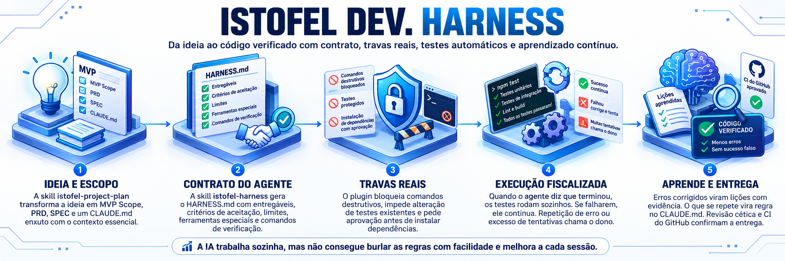

<p align="center">
    
</p>

<hr/>

# istofel-dev-harness

Plugin para o **Claude Code** que leva um projeto da ideia ao código verificado.
O agente de IA trabalha sozinho, mas sob um **contrato com travas reais**: ele não consegue
declarar sucesso com testes falhando, apagar o que não deve nem "consertar" testes para que passem.

## O que o plugin faz

| Componente | Função |
|---|---|
| `istofel-project-plan` | Gera MVP Scope → PRD → SPEC → CLAUDE.md, um documento por vez |
| `istofel-harness` | Cria o contrato `HARNESS.md` e instala as travas no projeto |
| Hooks automáticos | Bloqueiam ações perigosas e rodam os testes quando o agente diz "terminei" |
| `harness-reviewer` | Revisor independente e cético, sem permissão para editar |

**Na prática:**
1. Comandos destrutivos (`rm -rf`, `git push --force`, `git reset --hard`, `sudo`) são bloqueados.
2. Testes existentes não podem ser alterados nem apagados. Testes novos são permitidos.
3. Instalar dependências exige a sua aprovação.
4. Ao encerrar, os testes rodam sozinhos. Se falharem, o agente é obrigado a continuar.
5. Se o mesmo erro se repetir 2 vezes, ou após 4 tentativas, o agente para, mostra o erro e espera você.
6. **Aprende com os erros:** quando uma verificação falha e depois passa, a evidência vai para
   `docs/lessons.md`, o agente escreve a lição e as lições recentes entram nas próximas sessões.
7. O GitHub Actions repete a verificação fora da máquina do agente.

**Contexto enxuto:** o `CLAUDE.md` e o `HARNESS.md` são lidos em toda sessão, então só contêm o que
o agente não consegue descobrir no código. Nada de árvore de diretórios, stack ou comandos padrão,
como recomenda o estudo da ETH Zürich ([Gloaguen et al., 2026](https://arxiv.org/abs/2602.11988)).

## Requisitos

- [Claude Code](https://docs.claude.com/en/docs/claude-code/overview) instalado e logado
- [Git](https://git-scm.com/downloads). No Windows, o Git for Windows inclui o Git Bash, usado pelos hooks.
- [Python 3.8+](https://www.python.org/downloads/). No Windows, marque **"Add python.exe to PATH"** na instalação.

## Instalação

> Este repositório é privado. Antes de instalar, a sua máquina precisa conseguir clonar repositórios
> privados do GitHub, usando `gh auth login` ou uma chave SSH.

### Windows (PowerShell)

```powershell
git --version
python --version
claude plugin marketplace add istofel/istofel-dev-harness
claude plugin install istofel-dev@istofel
```

### Linux / macOS (terminal)

```bash
git --version
python3 --version
claude plugin marketplace add istofel/istofel-dev-harness
claude plugin install istofel-dev@istofel
```

Confira com `claude plugin list`. O item `istofel-dev@istofel` deve aparecer como *enabled*.

**Atualizar:** `claude plugin marketplace update istofel`
**Remover:** `claude plugin uninstall istofel-dev@istofel`

## Como usar

1. **Planejar.** Dentro do Claude Code, digite `/istofel-dev:istofel-project-plan` ou apenas descreva a sua ideia.
2. **Configurar o harness.** Na pasta do projeto (um repositório Git), digite `/istofel-dev:istofel-harness`.
   A skill faz até 3 perguntas, escreve o `HARNESS.md` e instala as travas.
3. **Salvar a configuração.**
   ```bash
   git add HARNESS.md CLAUDE.md .harness .claude/settings.json .github docs
   git commit -m "harness"
   ```
4. **Reiniciar o Claude Code** e trabalhar normalmente.
5. **Antes de entregar,** peça: *"faça uma revisão independente"*.
6. **De tempos em tempos,** rode o `audit`. Quando ele apontar uma falha recorrente em
   `docs/lessons.md`, transforme a lição numa linha `NUNCA` do `CLAUDE.md`.

### Comandos úteis (na raiz do projeto)

No Windows use `python`; no Linux e macOS, `python3`.

| Comando | Para quê |
|---|---|
| `python .harness/harness.py status` | Ver o estado (verificação, tentativas, escalação) |
| `python .harness/harness.py verify` | Rodar a verificação manualmente |
| `python .harness/harness.py audit` | Auditar o harness do projeto |
| `python .harness/harness.py approve-tests` | Aprovar testes novos, depois de revisá-los |
| `python .harness/harness.py scope "src/auth/**"` | Limitar a tarefa a certos arquivos (`--clear` libera) |
| `python .harness/harness.py reset` | Zerar tentativas e escalação |

Os comandos `approve-tests`, `scope` e `reset` são só seus: o agente é bloqueado se tentar usá-los.

**Editar o contrato:** o `HARNESS.md` é protegido. Para alterá-lo com ajuda do agente, abra uma
sessão sem as travas:
- Linux/macOS: `HARNESS_DISABLE=1 claude`
- Windows (PowerShell): `$env:HARNESS_DISABLE=1; claude`

Depois feche essa sessão. No Windows, rode também `Remove-Item Env:HARNESS_DISABLE`.

## Limites

- As travas valem no **Claude Code**. No chat do claude.ai, o `HARNESS.md` é só texto.
- Testes fracos também passam. Revise os testes novos antes de aprovar.
- O sandbox opcional do sistema operacional funciona no macOS, no Linux (com `bubblewrap`) e no WSL2.
- Nenhuma ferramenta elimina 100% do risco. Use junto com Git, CI e a sua revisão.

Detalhes técnicos: [`plugins/istofel-dev/skills/istofel-harness/references/travas.md`](plugins/istofel-dev/skills/istofel-harness/references/travas.md)

## Licença

[Apache-2.0](LICENSE) © Vinícius Istofel Oliveira
